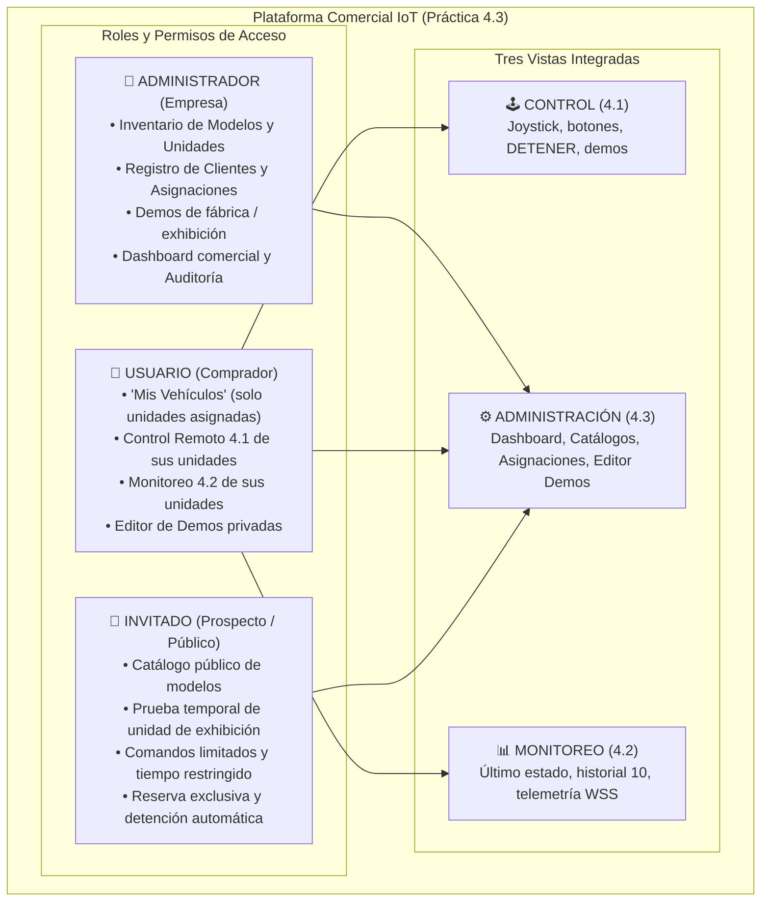

# Contexto de Arquitectura y Guía de Implementación — Práctica 4.3
**Asignatura:** Implementación de Soluciones IoT  
**Docente:** M.C. Víctor Manuel Pinedo Fernández  
**Módulo:** 4.3 Aplicación de Administración IoT (Plataforma Comercial Multiusuario)  
**Proyecto:** Integración CONTROL (4.1) + MONITOREO (4.2) + ADMINISTRACIÓN (4.3)

---

## 1. Visión General del Proyecto y Modelo de Negocio

La práctica 4.3 amplía el ecosistema IoT preexistente para convertirlo en una **plataforma comercial multiusuario** que representa a una empresa fabricante y comercializadora de vehículos IoT (como excavadoras o vehículos autónomos).

### Los Tres Roles Comerciales:

---

## 2. Diagnóstico del Estado Actual (Matriz de Brechas)

### 2.1. Base de Datos (Amazon RDS MySQL)
* **Tablas Actuales (6):**
  1. `vehiculos` (Actualmente mezcla concepto de *modelo* con *unidad física*).
  2. `comandos` (Catálogo de 12 comandos vinculados a un vehículo).
  3. `estado_vehiculo` (Conectividad y último comando ejecutado).
  4. `historial_comandos` (Bitácora de movimientos individuales, con más de 1,230 registros históricos reales).
  5. `demos` (Rutinas pregrabadas de demostración).
  6. `demo_movimientos` (Pasos ordenados de cada demo con duraciones en ms).
* **21 Stored Procedures:** Deben permanecer 100% operativos para garantizar compatibilidad con las vistas 4.1 y 4.2.
* **Brecha a Resolver (Nuevas Tablas y Extensiones):**
  * Tabla `usuarios` y `roles` (RBAC con hash bcrypt / argon2).
  * Tabla `modelos_vehiculo` para separar el **Modelo Comercial** (ej. *Excavadora Hidráulica X-200*) de la **Unidad Física** (ej. *Unidad con número de serie / chasis / MAC*).
  * Extensión en `vehiculos`: agregar `id_modelo`, `id_usuario_propietario`, `estado_comercial` (`DISPONIBLE`, `VENDIDO`, `EXHIBICION`, `INACTIVO`).
  * Extensión en `demos`: agregar `id_usuario` y `tipo_demo` (`FABRICA`, `PRIVADA`).
  * Tabla `sesiones_invitado` para el control de turnos temporales exclusivos.
  * Tabla `auditoria_sistema` para registrar altas, asignaciones, bajas y accesos.

### 2.2. Backend (FastAPI en AWS EC2 Windows Server)
* **Estado Actual:** 21 endpoints REST y 2 endpoints WebSocket (`/ws` y `/ws/{id_vehiculo}`).
* **Brecha a Resolver:**
  * Endpoint de Autenticación (`POST /auth/login`, `GET /auth/me`).
  * Dependencia de seguridad en FastAPI: Validación de JWT / Sesión Bearer y verificación de propiedad por recurso (evitar vulnerabilidades IDOR/BOLA).
  * Routers modulares para: Modelos, Unidades, Asignaciones/Clientes, Editor de Demos y Sesiones de Invitado.
  * Autorización WSS: Validar que el usuario que abre el socket hacia `/ws/{id_vehiculo}` sea su legítimo dueño o tenga sesión de soporte/invitado activa.

### 2.3. Frontend (React + Vite + Tailwind en Vercel / GitHub Pages)
* **Estado Actual:** Dos pestañas funcionales (`CONTROL` y `MONITORING`).
* **Brecha a Resolver:**
  * Integrar navegación de 3 pestañas: `CONTROL` | `MONITOREO` | `ADMINISTRACIÓN`.
  * Barra de sesión de usuario en el Header (Login / Logout / Selector de Rol / Indicador de Usuario activo).
  * Vistas contextuales de Administración:
    * **Para Admin:** Dashboard de métricas, gestión de catálogo de modelos, gestión de unidades, gestión de clientes y asignaciones, registro de auditoría.
    * **Para Usuario:** Selector "Mis Vehículos", editor visual interactivo de Demos privadas (añadir, reordenar y probar pasos).
    * **Para Invitado:** Catálogo público comercial y botón "Probar Unidad de Exhibición" con cuenta regresiva.
  * Preservar los **3 indicadores independientes de estado**: WSS navegador, API AWS y diagnóstico RDS.

---

## 3. Plan de Migración de Base de Datos (No Destructivo)

> [!CAUTION]
> En MySQL, las sentencias `ALTER TABLE` y `CREATE TABLE` ejecutan un commit implícito inmediato. No se puede confiar en un `ROLLBACK`. Todos los scripts deben ser versionados, idempotentes (`IF NOT EXISTS`) y comprobados previamente en un esquema de prueba.

### Estructura de Scripts Versionados:
* `V4.3__01_crear_tablas_auth_y_modelos.sql`:
  * Crear `roles` (`ADMINISTRADOR`, `USUARIO`, `INVITADO`).
  * Crear `usuarios` (`id_usuario`, `nombre`, `email`, `password_hash`, `id_rol`, `activo`, `fecha_registro`).
  * Crear `modelos_vehiculo` (`id_modelo`, `nombre`, `descripcion`, `tipo_maquinaria`, `foto_url`, `activo`).
* `V4.3__02_alterar_vehiculos_y_demos.sql`:
  * Agregar columnas a `vehiculos` respetando los datos ya existentes:
    * `id_modelo` INT NULL (vinculado a `modelos_vehiculo`).
    * `id_usuario_propietario` INT NULL (vinculado a `usuarios`).
    * `estado_comercial` ENUM('DISPONIBLE', 'VENDIDO', 'EXHIBICION', 'MANTENIMIENTO') DEFAULT 'EXHIBICION'.
    * `numero_serie` VARCHAR(50) UNIQUE NULL.
  * Agregar columnas a `demos`:
    * `id_usuario` INT NULL.
    * `tipo_demo` ENUM('FABRICA', 'PRIVADA') DEFAULT 'FABRICA'.
* `V4.3__03_crear_sesiones_invitado_y_auditoria.sql`:
  * Crear `sesiones_invitado` (`id_sesion`, `id_vehiculo`, `token_sesion`, `ip_origen`, `inicia_en`, `expira_en`, `activa`).
  * Crear `auditoria_sistema` (`id_auditoria`, `id_usuario`, `accion`, `entidad`, `id_entidad`, `detalle`, `fecha_hora`).
* `V4.3__04_seed_datos_iniciales.sql`:
  * Crear usuarios demo de prueba:
    1. Admin: `admin@empresa-iot.com` / `Admin123!`
    2. Usuario comprador: `cliente@gmail.com` / `Cliente123!`
    3. Invitado: `invitado@publico.com` / `Invitado123!`
  * Asignar el vehículo actual (ID 1) como unidad de exhibición de la empresa para pruebas públicas.

---

## 4. Matriz de Endpoints de FastAPI

| Método | Endpoint | Rol Requerido | Propósito |
| :--- | :--- | :--- | :--- |
| **POST** | `/auth/login` | Público | Autenticar credenciales y generar token JWT. |
| **GET** | `/auth/me` | Autenticado | Obtener información del usuario logueado y su rol. |
| **GET** | `/modelos` | Público / Todos | Catálogo comercial de modelos disponibles. |
| **POST** | `/modelos` | Admin | Crear nuevo modelo comercial. |
| **GET** | `/unidades` | Admin | Inventario completo de unidades físicas y su estado comercial. |
| **POST** | `/unidades` | Admin | Dar de alta una unidad física (número de serie, MAC, microcontrolador). |
| **POST** | `/unidades/{id}/asignar` | Admin | Asignar o reasignar una unidad a un cliente comprador. |
| **GET** | `/usuarios/clientes` | Admin | Directorio de clientes registrados. |
| **POST** | `/usuarios/clientes` | Admin | Alta de nuevo comprador. |
| **GET** | `/mis-vehiculos` | Usuario | Listado exclusivo de unidades que pertenecen al comprador actual. |
| **POST** | `/demos` | Admin / Usuario | Crear demo (Fábrica si es Admin, Privada si es Usuario). |
| **PUT** | `/demos/{id}/movimientos` | Propietario / Admin | Reordenar y editar la secuencia de pasos de una demo. |
| **POST** | `/invitado/solicitar-prueba` | Invitado / Público | Solicitar reserva temporal exclusiva de una unidad de exhibición. |
| **POST** | `/invitado/liberar-prueba` | Invitado / Público | Liberar la unidad y enviar `DETENER` inmediato. |
| **GET** | `/auditoria` | Admin | Consultar bitácora de eventos administrativos y de seguridad. |

---

## 5. Hoja de Ruta de Implementación en 9 Etapas

1. **Etapa 1 — Diagnóstico y Matriz de Brechas (Completada en este documento):**  
   Auditoría de las 21 APIs, del esquema actual y de los eventos WSS.
2. **Etapa 2 — Respaldo, Diseño ER y Scripts SQL Versionados:**  
   Generación de scripts SQL de migración y reversión sin tocar los datos actuales.
3. **Etapa 3 — Ejecución de Migración en Amazon RDS y Verificación:**  
   Aplicación de los scripts en la base de datos `database-1.cidzofm0szn8.us-east-1.rds.amazonaws.com`.
4. **Etapa 4 — Ampliación de FastAPI (Auth, JWT y RBAC con validación por recurso):**  
   Implementación de routers modulares y protección contra accesos cruzados (IDOR).
5. **Etapa 5 — Frontend: Módulo de Administración (Dashboard, Inventario y Clientes):**  
   Creación de la interfaz responsiva de administración para el rol Administrador.
6. **Etapa 6 — Frontend: Selector "Mis Vehículos" y Editor Visual de Demos:**  
   Experiencia del Usuario comprador para diseñar y reordenar sus secuencias.
7. **Etapa 7 — Sesiones de Invitado y Reserva Exclusiva de Exhibición:**  
   Flujo público con temporizador regresivo, bloqueo simultáneo y detención segura.
8. **Etapa 8 — Integración de WSS por Recurso e Indicadores de Conectividad:**  
   Aislamiento estricto de eventos por vehículo y presencia de los 3 semáforos de salud.
9. **Etapa 9 — Pruebas Cruzadas en Equipo, Evidencias y Publicación:**  
   Validación con los compañeros rotando roles (Admin, Usuario, Invitado), verificación en Vercel y GitHub Pages.
