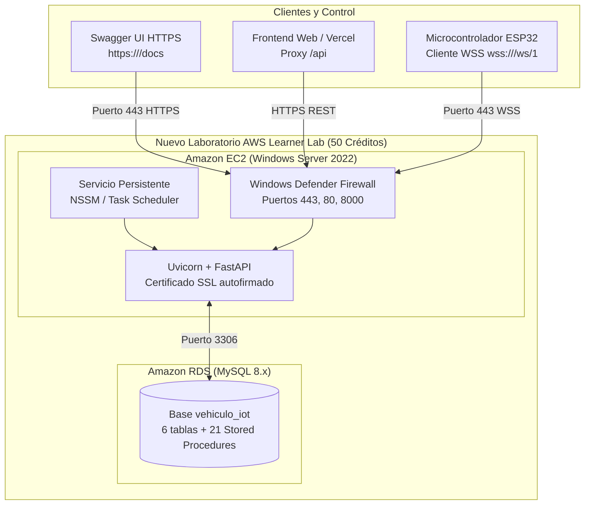

# Guía Maestra de Migración de Infraestructura AWS (Laboratorio Escolar)
**Proyecto:** Teleoperación y Monitoreo IoT — Excavadora / Vehículo Autónomo  
**Componentes a migrar:** Servidor Backend FastAPI (EC2 Windows Server) y Base de Datos Relacional (Amazon RDS MySQL).  
**Contexto de la migración:** Cambio de cuenta AWS Learner Lab debido a agotamiento de créditos (45/50 USD consumidos).

---

## 1. Resumen de la Arquitectura en AWS



---

## 2. Inventario de Componentes y Estado de Respaldo

| Componente | Detalle / Configuración Actual | Estado de Respaldo Local |
| :--- | :--- | :--- |
| **Base de Datos (RDS)** | `instancia-rds-iot` (MySQL 8.4) en `us-east-1`<br>Base: `vehiculo_iot`<br>Usuario: `admin`<br>Password: `vehiculo_iot` | ✅ **Respaldado al 100%** en [`db/backup_current_rds.sql`](file:///home/lcmarquez/Documents/IoT/db/backup_current_rds.sql) (Incluye esquema, los 21 Stored Procedures y 1,235 registros de telemetría/historial). |
| **Backend API (EC2)** | Windows Server 2022 / 2019<br>Python 3.11+, FastAPI, POO<br>Puerto 443 HTTPS y WSS con `cert.pem` y `key.pem` | ✅ **Código fuente íntegro** en [`websocket_iot/`](file:///home/lcmarquez/Documents/IoT/websocket_iot). |
| **Microcontrolador** | ESP32 / ESP8266 WSS client | ⏳ Requiere únicamente actualizar `WS_HOST` en [`firmware/esp32_excavadora_iot/esp32_excavadora_iot.ino`](file:///home/lcmarquez/Documents/IoT/firmware/esp32_excavadora_iot/esp32_excavadora_iot.ino#L33) con el nuevo DNS de EC2. |
| **Frontend Web** | Interfaz de control y telemetría | ⏳ Requiere únicamente actualizar `VITE_API_BASE_URL` en [`frontend/.env`](file:///home/lcmarquez/Documents/IoT/frontend/.env) con la nueva IP/DNS de EC2. |

---

## 3. Fase 1: Creación de Grupos de Seguridad (Security Groups)

En la consola del **Nuevo Laboratorio AWS**:

1. Ve a **VPC** o **EC2** > **Security Groups** > **Create Security Group**.
2. **Grupo 1: `sg-ec2-iot`** (Para el servidor Windows):
   - **VPC:** La VPC por defecto.
   - **Inbound Rules (Reglas de entrada):**
     - `RDP` | TCP | Puerto `3389` | Source: `Anywhere-IPv4` (`0.0.0.0/0`) *(Para administración remota)*.
     - `HTTPS` | TCP | Puerto `443` | Source: `Anywhere-IPv4` (`0.0.0.0/0`) *(Swagger /docs y WebSocket WSS)*.
     - `HTTP` | TCP | Puerto `80` | Source: `Anywhere-IPv4` (`0.0.0.0/0`) *(Opcional / Redirección)*.
     - `Custom TCP` | TCP | Puerto `8000` | Source: `Anywhere-IPv4` (`0.0.0.0/0`) *(Pruebas directas de desarrollo)*.
3. **Grupo 2: `sg-rds-iot`** (Para la base de datos MySQL):
   - **VPC:** La misma VPC por defecto.
   - **Inbound Rules (Reglas de entrada):**
     - `MYSQL/Aurora` | TCP | Puerto `3306` | Source: `Anywhere-IPv4` (`0.0.0.0/0`) *(Permite restaurar el backup desde tu máquina local y conectar la EC2)*.

---

## 4. Fase 2: Despliegue de la Base de Datos Amazon RDS MySQL

> [!TIP]
> En AWS Learner Lab, deshabilitar el "Autoscaling de Almacenamiento" y los respaldos automatizados largos reduce drásticamente el consumo de créditos.

1. Ve a **Amazon RDS** > **Databases** > **Create database**.
2. **Método de creación:** Standard create.
3. **Engine options:** MySQL (Versión 8.0 o 8.4).
4. **Templates:** **Free Tier** (Capa gratuita / Dev).
5. **Settings:**
   - DB instance identifier: `instancia-rds-iot`
   - Master username: `admin`
   - Master password: `vehiculo_iot`
   - Confirm password: `vehiculo_iot`
6. **Instance configuration:**
   - Burstable classes: `db.t3.micro` o `db.t4g.micro`.
7. **Storage:**
   - Storage type: General Purpose SSD (`gp2` o `gp3`).
   - Allocated storage: `20` GiB.
   - **Desmarcar** *"Enable storage autoscaling"*.
8. **Connectivity:**
   - Virtual private cloud: Default VPC.
   - **Public access:** **Yes** (Obligatorio para restaurar desde local).
   - Existing VPC security groups: Selecciona `sg-rds-iot` (deselecciona `default`).
9. **Additional configuration:**
   - **Initial database name:** `vehiculo_iot` *(Muy importante: esto crea la base vacía de inmediato)*.
   - Automatic backups: Reducir retención a 1 día.
10. Clic en **Create database** (tardará entre 5 y 10 minutos).

---

## 5. Fase 3: Restauración del Esquema, SPs y Datos en la Nueva RDS

Una vez que la nueva RDS pase a estado **Available**, copia su nuevo **Endpoint** (ejemplo: `instancia-rds-iot.cxxxxxxx.us-east-1.rds.amazonaws.com`).

Desde tu terminal local (donde ya generamos [`backup_current_rds.sql`](file:///home/lcmarquez/Documents/IoT/db/backup_current_rds.sql)), ejecuta:

```bash
# Restaurar todo el respaldo (Tablas + 1235 Registros + 21 Stored Procedures)
mariadb -h <NUEVO_ENDPOINT_RDS> -P 3306 -u admin -pvehiculo_iot --ssl-verify-server-cert=0 vehiculo_iot < /home/lcmarquez/Documents/IoT/db/backup_current_rds.sql
```

Para verificar que la restauración fue exitosa:
```bash
mariadb -h <NUEVO_ENDPOINT_RDS> -P 3306 -u admin -pvehiculo_iot --ssl-verify-server-cert=0 -e "
USE vehiculo_iot;
SHOW TABLES;
SELECT COUNT(*) AS total_historico FROM historial_comandos;
SHOW PROCEDURE STATUS WHERE Db = 'vehiculo_iot';
"
```
*(Deberás ver las 6 tablas, los 1,235 registros en historial y los 21 procedimientos almacenados).*

---

## 6. Fase 4: Despliegue de la Instancia EC2 Windows Server

1. Ve a **Amazon EC2** > **Instances** > **Launch an instance**.
2. **Name:** `Servidor-IoT-Backend`
3. **Application and OS Images:**
   - Selecciona **Windows**.
   - AMI: `Microsoft Windows Server 2022 Base - ami-...` (64 bits x86).
4. **Instance type:**
   - `t2.micro` o `t3.medium` (según disponibilidad del laboratorio).
5. **Key pair (login):**
   - Selecciona `vockey` (la llave por defecto de AWS Academy) o crea una nueva llamada `iot-server-key.pem` y descárgala.
6. **Network settings:**
   - Selecciona el Security Group existente: `sg-ec2-iot`.
   - Auto-assign Public IP: **Enable**.
7. **Storage:**
   - 30 GiB gp3 (por defecto para Windows Server).
8. Clic en **Launch instance**.

---

## 7. Fase 5: Configuración Interna de Windows Server (RDP)

### 7.1. Conexión RDP
1. En la consola EC2, selecciona la instancia y pulsa **Connect** > pestaña **RDP client**.
2. Pulsa **Get password**, sube tu archivo `.pem` (o el de `vockey`) y descifra la contraseña del usuario `Administrator`.
3. Conéctate vía cliente RDP (Remmina en Linux, o Remote Desktop en Windows):
   - **Equipo/Host:** IP Pública o DNS Público de la nueva EC2.
   - **Usuario:** `Administrator`
   - **Contraseña:** La contraseña descifrada.

### 7.2. Abrir Puertos en Windows Defender Firewall
Dentro de Windows Server, abre **PowerShell como Administrador** y ejecuta:

```powershell
New-NetFirewallRule -DisplayName "HTTPS Port 443" -Direction Inbound -LocalPort 443 -Protocol TCP -Action Allow
New-NetFirewallRule -DisplayName "HTTP Port 80" -Direction Inbound -LocalPort 80 -Protocol TCP -Action Allow
New-NetFirewallRule -DisplayName "Port 8000" -Direction Inbound -LocalPort 8000 -Protocol TCP -Action Allow
```

### 7.3. Instalar Python 3.11 o superior
En PowerShell:
```powershell
winget install Python.Python.3.11 --accept-source-agreements --accept-package-agreements
```
*(O descarga directamente el instalador desde python.org asegurándote de marcar "Add python.exe to PATH")*.

### 7.4. Desplegar el Backend y Configurar el Entorno
1. Crea la carpeta en Windows:
   ```powershell
   New-Item -ItemType Directory -Force -Path "C:\Users\Administrator\Documents\websocket_iot"
   cd "C:\Users\Administrator\Documents\websocket_iot"
   ```
2. Copia los archivos del proyecto (puedes transferir el archivo `websocket_iot` vía portapapeles RDP o subir un `.zip`).
3. Crea y activa el entorno virtual:
   ```powershell
   python -m venv .venv
   .\.venv\Scripts\Activate.ps1
   pip install --upgrade pip
   pip install -r requirements.txt
   ```
4. Edita el archivo `.env` en `C:\Users\Administrator\Documents\websocket_iot\.env` con el **NUEVO Endpoint de RDS**:
   ```env
   DB_HOST=<NUEVO_ENDPOINT_RDS>
   DB_PORT=3306
   DB_USER=admin
   DB_PASSWORD=vehiculo_iot
   DB_NAME=vehiculo_iot
   ```
5. Prueba la conexión a la base de datos:
   ```powershell
   python -c "from app.database.connection import db_manager; print(db_manager.test_connection())"
   ```

### 7.5. Generar Certificado SSL Autofirmado (para HTTPS y WSS)
En la misma consola de PowerShell, genera los certificados vinculados a la nueva IP pública:

```powershell
cd C:\Users\Administrator\Documents\websocket_iot

# Reemplaza NUEVA_IP_PUBLICA por la IP pública de tu nueva EC2
$publicIp = "<NUEVA_IP_PUBLICA_EC2>"

.venv\Scripts\python.exe -c "
import datetime
from cryptography import x509
from cryptography.x509.oid import NameOID
from cryptography.hazmat.primitives import hashes, serialization
from cryptography.hazmat.primitives.asymmetric import rsa

key = rsa.generate_private_key(public_exponent=65537, key_size=2048)
with open('key.pem', 'wb') as f:
    f.write(key.private_bytes(
        encoding=serialization.Encoding.PEM,
        format=serialization.PrivateFormat.TraditionalOpenSSL,
        encryption_algorithm=serialization.NoEncryption()
    ))

subject = issuer = x509.Name([
    x509.NameAttribute(NameOID.COMMON_NAME, '$publicIp')
])
cert = x509.CertificateBuilder().subject_name(
    subject
).issuer_name(
    issuer
).public_key(
    key.public_key()
).serial_number(
    x509.random_serial_number()
).not_valid_before(
    datetime.datetime.now(datetime.timezone.utc)
).not_valid_after(
    datetime.datetime.now(datetime.timezone.utc) + datetime.timedelta(days=365)
).sign(key, hashes.SHA256())

with open('cert.pem', 'wb') as f:
    f.write(cert.public_bytes(serialization.Encoding.PEM))

print('Certificados key.pem y cert.pem creados exitosamente.')
"
```

### 7.6. Configurar como Servicio Persistente en Windows (NSSM o Task Scheduler)
Para que el servidor se mantenga activo aunque cierres la sesión RDP:

1. **Opción con NSSM:**
   ```cmd
   nssm install IoTServer "C:\Users\Administrator\Documents\websocket_iot\.venv\Scripts\python.exe" "-m uvicorn app.main:app --host 0.0.0.0 --port 443 --ssl-keyfile key.pem --ssl-certfile cert.pem"
   nssm set IoTServer AppDirectory "C:\Users\Administrator\Documents\websocket_iot"
   nssm start IoTServer
   ```
2. **Opción con Windows Task Scheduler** (Nativa):
   ```powershell
   $Action = New-ScheduledTaskAction -Execute "C:\Users\Administrator\Documents\websocket_iot\.venv\Scripts\python.exe" -Argument "-m uvicorn app.main:app --host 0.0.0.0 --port 443 --ssl-keyfile key.pem --ssl-certfile cert.pem" -WorkingDirectory "C:\Users\Administrator\Documents\websocket_iot"
   $Trigger = New-ScheduledTaskTrigger -AtStartup
   $Principal = New-ScheduledTaskPrincipal -UserId "SYSTEM" -LogonType ServiceAccount -RunLevel Highest
   $Settings = New-ScheduledTaskSettingsSet -AllowStartIfOnBatteries -DontStopIfGoingOnBatteries -RestartCount 3 -RestartInterval (New-TimeSpan -Minutes 1)
   Register-ScheduledTask -TaskName "IoT-Backend-Server" -Action $Action -Trigger $Trigger -Principal $Principal -Settings $Settings -Force
   Start-ScheduledTask -TaskName "IoT-Backend-Server"
   ```

---

## 8. Fase 6: Actualización de Punteros en Firmware y Frontend

Una vez desplegada la nueva EC2, solo hay que actualizar 2 variables:

1. **Firmware ESP32:**
   - Archivo: [`firmware/esp32_excavadora_iot/esp32_excavadora_iot.ino`](file:///home/lcmarquez/Documents/IoT/firmware/esp32_excavadora_iot/esp32_excavadora_iot.ino#L33)
   - Cambiar:
     ```cpp
     const char* WS_HOST = "ec2-XX-XX-XX-XX.compute-1.amazonaws.com"; // Nuevo DNS o IP de EC2
     ```
   - Compilar y subir al microcontrolador.

2. **Frontend:**
   - Archivo: [`frontend/.env`](file:///home/lcmarquez/Documents/IoT/frontend/.env)
   - Cambiar:
     ```env
     VITE_API_BASE_URL=https://ec2-XX-XX-XX-XX.compute-1.amazonaws.com
     ```
   - Si usas el bridge en Vercel, actualizar la variable de entorno correspondiente en el dashboard de Vercel.

---

## 9. Fase 7: Matriz de Validación Post-Migración

| Prueba | Comando / URL | Resultado Esperado |
| :--- | :--- | :--- |
| **1. Swagger UI HTTPS** | `https://<NUEVO_EC2>/docs` | Carga Swagger UI con los 21 endpoints activos. |
| **2. Salud del Servidor** | `GET https://<NUEVO_EC2>/status` | HTTP 200 con `{"ESTADO": ...}`. |
| **3. Catálogo Vehículo** | `GET https://<NUEVO_EC2>/vehiculos/1` | Retorna datos de la excavadora desde la nueva RDS. |
| **4. Conexión WSS** | `wss://<NUEVO_EC2>/ws/1` | Recibe evento `ESTADO_INICIAL` en Thunder Client / ESP32. |
| **5. Prueba de Movimiento** | `POST https://<NUEVO_EC2>/vehiculos/1/movimiento` con `{"id_comando": 1}` | Respuesta HTTP 200 y registro inmediato en `historial_comandos`. |

---

## 10. Buenas Prácticas de Presupuesto en AWS Learner Lab

> [!WARNING]
> Para no volver a agotar los 50 créditos del nuevo laboratorio:
> 1. **Detener la instancia EC2** cuando no estés en clase o haciendo pruebas (AWS cobra por hora de máquina encendida).
> 2. **Detener la instancia RDS** (Stop database) si pasarán días sin utilizarse.
> 3. Al terminar la evaluación de la materia, exportar el dump final y hacer **Terminate** de la EC2 y **Delete** de la RDS para evitar cargos residuales de almacenamiento.
